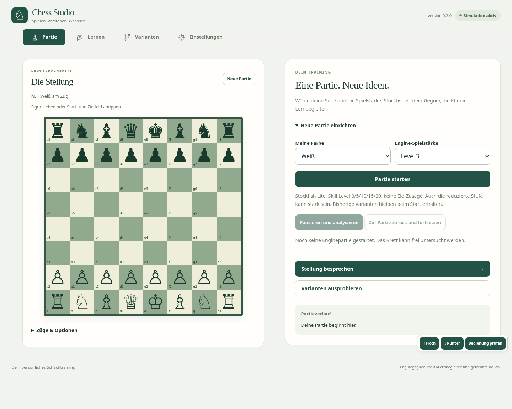

# AI-Chess-Studio 0.2.0 – neue Tab-Oberflaeche

Datei: [AI-Chess-Studio-0.2.0-Windows.zip](AI-Chess-Studio-0.2.0-Windows.zip)
Vier Arbeitsbereiche: Partie, Lernen, Varianten und Einstellungen.
Gemeinsames Brett und Entwuerfe bleiben erhalten. Zusatzoptionen aufklappbar;
Desktop nebeneinander, Telefon/Tablet mit fester Navigation unten.

[Lerndialog ansehen](Chess-Studio-0.2.0-Lernen.png) · [Mobilansicht](Chess-Studio-0.2.0-Mobil.png)

Vor dem Wechsel aktuelle Sitzung exportieren. Alte App-Tabs und Serverfenster
schliessen, ZIP vollstaendig entpacken und im Ordner AI-Chess-Studio-0.2.0
AI-Chess-Studio-starten.cmd starten. Gespeicherter Schluessel im Benutzerprofil
bleibt erhalten. Einstellungen enthalten jetzt Schluessel, Budget und Sicherung.

Typpruefung, Build, 68 Einzeltests und 34 Chromium-Browsertests bestanden.
Desktop-/Mobil-Screenshots zeigen die echte gebaute App, keine Mockups.
Die responsive Oberflaeche nutzt weiterhin das lokale Desktop-Backend.
Eigenstaendiger Android-/iPad-/Offlinebetrieb erfordert weitere Adapter;
keine native Geraeteabnahme behauptet. Kein Provideraufruf, Release/Deployment
oder Wechsel der Repository-Sichtbarkeit. Keine Schluessel im Paket.

Quellcommit: 11c4c45f50a081833b371596bd9a2a66b95e51f5
SHA-256: 45a516a34eb676f6ece6887a87078591abf30c6da798b8c7c6eca5d3c53b549b
